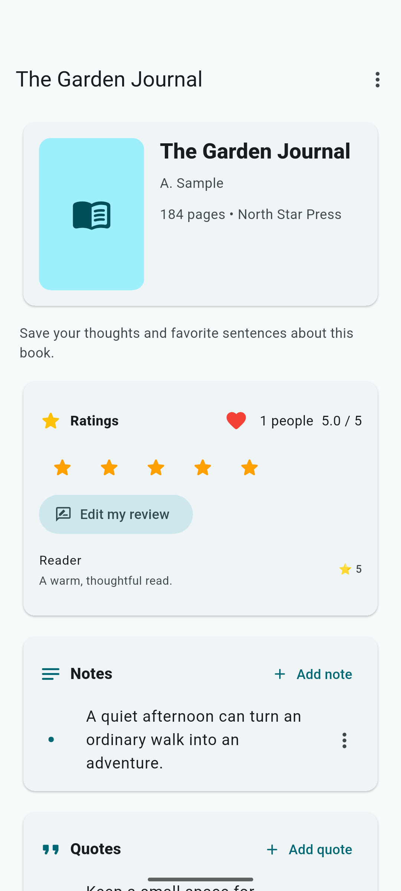
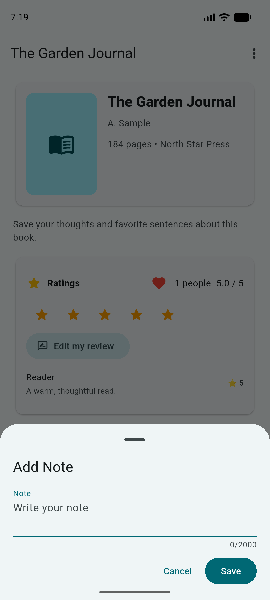

<div align="center">
  

# Book Library

**A thoughtful home for the books you own and the ones you are reading.**

Organize your collection, keep notes and favorite quotes, and read offline on Android.

[](https://github.com/kargalar/booklibrary/releases/latest) [](https://github.com/kargalar/booklibrary/releases/latest) [](https://github.com/kargalar/booklibrary/releases/latest) [](LICENSE)

[Download the latest release ↓](https://github.com/kargalar/booklibrary/releases/latest) · [Build from source](#build-from-source) · [Report an issue](https://github.com/kargalar/booklibrary/issues)

</div>



## Keep your reading life in one place

Track the books you own, the ones you are reading, and the titles you want to find next. Add notes, save passages, rate books, and keep your reading progress close at hand.



## Features

- Organize books with reading status, ratings, notes, quotes, and tags.
- Search and compare book details from supported catalog providers.
- Read PDF and EPUB books and listen to audiobooks in the app.
- Track reading progress, loans, purchases, and library statistics.
- Store your library, notes, ratings, reading progress and files locally with SQLite.
- Open an existing migrated library without signing in or connecting to Firebase.

## Download

Get the latest Android APK or Windows x64 package from [GitHub Releases](https://github.com/kargalar/booklibrary/releases/latest). The Windows download is a ZIP containing the application executable and its required runtime files.

## Build from source

Install [Flutter](https://docs.flutter.dev/get-started/install) and the Android SDK. Android is the supported target for this local version. Firebase configuration and Google sign-in are not required. Optional book metadata lookups and unavailable remote covers still need internet; creating, editing, searching the imported catalog, reading saved files, and recording progress work offline.

```sh
flutter pub get
flutter analyze
flutter test
flutter build apk --release
```

Existing installations must be upgraded with the same application ID and signing key, without uninstalling or clearing app data. See [local migration and recovery](docs/local-migration.md). Historical Firebase maintenance scripts remain in `functions` for archive export and verification; they are not part of the Android application. Online friend requests, loan requests and reminders are unavailable in local mode; existing records and in-person loan tracking remain available.

## License

Book Library is licensed under the GNU General Public License v3.0. See [LICENSE](LICENSE).
